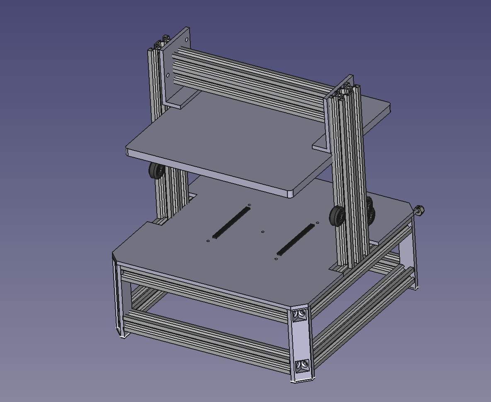

# UMMTJ (Universal Midscale Manufacturing Test Jig)

The UMMTJ (Universal Midscale Manufacturing Test Jig) is an open source programmer and test jig design designed to simplify the life of small electronic manufacturing companies and prototypists.

By defining hardware an software standards, it aims at making automated programming and testing of boards or panels cheap and easy. Along with the jig itself, the project will also include all the SDKs designed to operate the whole system. 

The ultimate goal is to be a turn-key solution with hardware, software and processes to simplify the design, build and use of a production-ready prog and test jig.

**Please [read the wiki here](https://github.com/vamatis/UMMTJ/wiki)!** The wiki covers information about all the design considerations, the state of the project, contributing instructions, and frequently asked questions.

Exported versions of the sources (STLs, schematic PDFs, compiled binaries, etc) can fbe found attached to the [latest release](https://github.com/vamatis/UMMTJ/releases).

## Project Goals:
The main project goals are as follow:

	- As much as possible, every part should be designed in a way to facilitate acces/modification by using open source tools
	- In the end, as much as the "automatable" stuff should be
	- If a standard is already in place, it should be followed if possible
	- Jig must be usable standalone (with an integrated single board computer) or as a "slave" for prototyping or debugging

There are multiple parts that I hope will be covered by the project in the end, to make it a real turn-key solution. The two main categories would be hardware and software.

### Hardware:

	- Design and build of the main frame for the jig
	PCB target dimmensions are 230x230mm to be able to run bigger boards or even small panels 
	As many of the shelf parts should be used, and the jig must be buildable without too much tools or experience
	- Design and build of the electronic boards to let the magic happen
	Most of the complexity should reside in the mainboard of the system, leaving "per-board" adapters to be as simple and cheap as possible
	As many use cases as practically viable should be taken into account

### Software:
	- KiCad plugin to automate the generation of the "per-board" adapters as much as possible
	- Firmware to run on the onboard microcontroller
	- SDK / application examples of the control software side, which operates the jig

## How do I get one?

As this project is at the very beginning, the only way to get one is to build it yourself using the BOM and Gerbers in the release pages. In the future, I hope to be able to sell kits for the system, as well as the individual parts.

## Contributing

As it might show, I'm not really an expert on the subject (on anything actually), so help is very welcome! If you would like to contribute to the project, Check out the [contributing page](https://github.com/vamatis/UMMTJ/wiki/contributing) to get started.

## Community

Discussion about the project happens on the [Discord server](https://discord.com/invite/uQHQamh2w4)!

